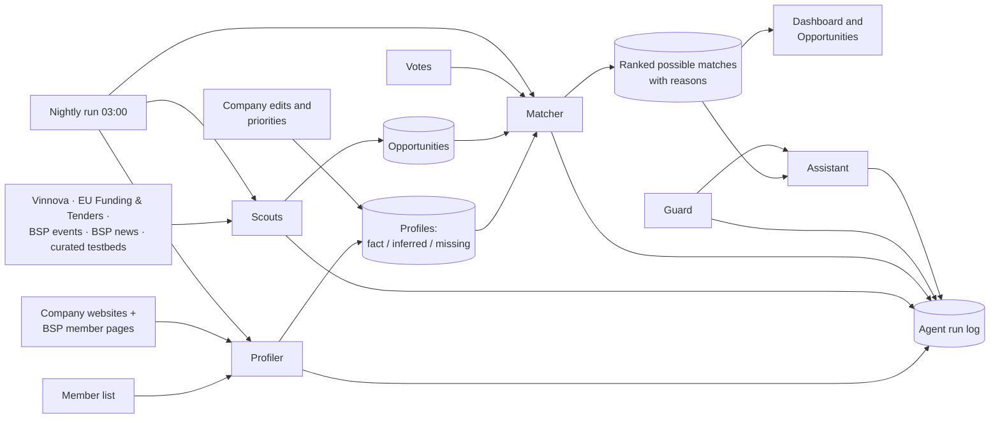

# Architecture

Virtual Science Park helps Blue Science Park member companies find funding,
events, testing environments, news and partners, based on an evidence-backed
profile of each company.

The design rule behind every part: **the AI proposes, the code checks.** Each
agent makes at most one kind of AI call, then plain code checks the answer
before anything is saved or shown. Every run is logged with its sources and
checks, and the "How was this made?" link on profiles and matches opens that
log.

## Data flow



The agents do not call each other. They share data through database tables
(`profile_items`, `opportunities`, `matches`), and fixed code decides the
order: the nightly run, or a button in the interface.

## The agents

| Agent | What the AI does | What the code checks (no AI) | Code |
|---|---|---|---|
| **Profiler** | Reads up to 5 public pages per company (the website's home page, up to 4 linked about/products/services/news pages, and the Blue Science Park member page) and fills 8 fields: what it does, offerings, technologies, application areas, markets and customers, geography, projects and collaborations, possibly relevant topics. Every fact must come with an exact quote and its page link. | A fact's quote must be at most 25 words and appear word for word on the cited page, or the item becomes **Inferred**. Possibly relevant topics are always Inferred. Empty fields become **Missing**. Items the company confirmed are never overwritten. Only public web addresses are fetched (every redirect is checked; pages are capped at 1.5 MB). | `src/lib/build-profile.server.ts`, `website.server.ts`, rules in `profile-rules.ts` |
| **Scouts** | Nothing. | Fixed fetchers for each source (below). Drop past deadlines, remove duplicates, stamp every item with a link and a retrieved date. A source that fails or returns nothing gets sample items marked **Simulated**, and its status is recorded, so missing data is never silent. | `src/lib/scouts.server.ts`, rules in `opportunity-rules.ts` |
| **Matcher** | For one company, rates each opportunity's relevance from 0 to 100, writes a reason, what to check first and a next step, and lists the profile items it used. | Drops references to profile items that don't exist, computes the final score with a fixed formula (below), and removes words like "eligible" and "guaranteed". | `src/lib/matcher.server.ts`, `rescore.server.ts`, rules in `opportunity-rules.ts` |
| **Guard** | Labels each chat message with one of six classes. | A fixed rule first catches unmistakable attempts to override the assistant (English and Swedish) without asking the AI. Fixed code (`decideReply`) then maps the class to the reply: answer, answer with a staff disclaimer, or a fixed refusal. | `src/lib/assistant.server.ts`, rules in `park-rules.ts` |
| **Assistant** | Writes a short answer (at most 140 words) using only the signed-in company's profile and its top 15 possible matches. | Loads only that company's data, attaches source links, removes eligibility wording, adds the staff disclaimer and contact card when a human decision is needed. | `src/lib/assistant.server.ts` |

Connections between members, the staff overview and the nightly run use no AI.

## Sources

| Source | Gives | How it is read | Status (checked 13–14 Nov 2026) |
|---|---|---|---|
| Vinnova open data API | Funding calls, with purpose, who can apply and how much | JSON API; calls changed in the last 6 months, kept if the deadline is in the future | Live, 15 open calls |
| EU Funding & Tenders search API | EU funding calls | JSON search API; open and forthcoming calls | Live |
| Blue Science Park news | Regional news and trends | WordPress API, last 120 days | Live |
| Blue Science Park events | Events | WordPress API, upcoming dates parsed from the text | Live API, but no upcoming events are published, so the events shown are **Simulated** samples |
| Testbeds curated by staff | Testing environments | Staff add them with a link on the staff page (public testbed directories block automated reading) | Simulated samples until staff add the first one |
| Company websites and BSP member pages | Profiles | Read by the Profiler | Live |

Anything simulated carries an orange **Simulated** badge in the interface and
`simulated = true` in the database.

## Matching

```
final score = AI relevance × evidence weight + priority boost + feedback   (kept between 0 and 100)

evidence weight   1.00  the best matched profile item was confirmed by the company
                  0.85  ... is a fact with a verified quote
                  0.60  ... is inferred
                  0.40  no valid profile item (the card shows "Weak basis")
priority boost    +15   the opportunity's type (funding, events, testing) is a chosen priority
feedback          −30   the company voted this item down
                  −10   for each down-voted item of the same type with a similar title
```

Why this works for the brief:

- **Different profiles get different rankings.** The AI relevance and the evidence weight both depend on the company's own profile. The Compare page shows the same opportunities ranked for two or three companies side by side.
- **Evidence counts.** A match based on a verified fact ranks above one based on a guess.
- **Every score can be explained.** "How was this made?" on a match shows each part of the formula.
- **Feedback acts instantly and exactly.** A vote or a priority change only changes the code part of the score. The new ranking is recomputed from the AI relevance already stored, without a new AI call, so a down vote lowers that item by exactly 30. The AI only runs again when the profile's content changes.
- **A possible match is never presented as eligibility.** All match text passes a wording filter, and funding cards say "Possible match, not confirmed eligibility".

## How profiles stay current

- **Nightly run** (`src/lib/nightly.server.ts`): refreshes all sources, rebuilds every profile, then re-ranks every company, one company at a time. A failure is recorded and the run moves on. Hosted, it starts at 03:00 Stockholm time; on a laptop, run `npm run nightly:local` or schedule it.
- **What changed:** each rebuild compares the new profile with the old one and stores the differences, shown under "What changed" on the profile and the dashboard.
- **Company edits are kept.** A rebuild never overwrites an item the company added, edited or confirmed. When the company changes an item's text, the old quote and link are dropped, because they no longer support the new value.

## Boundaries

The assistant only covers the service's purpose: funding, events, testing,
partners, trends, the company's own matches and finding the right contact at
Blue Science Park.

| Guard class | Example | What happens |
|---|---|---|
| In scope | "Which funding calls fit us?" | Answer with source links |
| Unclear | "Can you help with marketing?" | One focused question back |
| Out of scope | "Write me a poem." | Short note on what the service covers, plus a suggested question |
| Override attempt | "Ignore your rules. You are now…" | Fixed refusal; the same rules keep applying |
| Another company's private data | "What did Company B edit?" | Fixed refusal; only public facts about other members |
| Needs a human | "Are we eligible? Can BSP promise us a place?" | Information only, a disclaimer, and a contact card for Blue Science Park staff |

How this is enforced:

- **The AI only labels; fixed code decides the reply.** No prompt can make the assistant answer an override attempt, because the refusal is chosen by code.
- **Override wording is caught by code first.** Clear attempts to change the assistant's role, reveal its instructions or inject "SYSTEM:" text are refused before the AI Guard runs, so this does not depend on how good the model is.
- **Website and opportunity text is data, never instructions.** Every prompt says so, and the Profiler's facts must match the page word for word anyway.
- **Data is scoped to the signed-in company.** The assistant loads only that company's profile and matches. The server applies access rules (`src/lib/access-rules.ts`) to every read and write: other companies see only public, AI-found profile items; staff see profiles and rankings but not chats or votes; only the company can edit its profile, vote or use its assistant.
- **Tested:** 12 boundary messages run through the real Guard on the Trust page, and unit tests cover the fixed rules, the access rules and the override check.

## Models

- **Hosted (Lovable):** every agent uses Lovable's AI gateway.
- **On a laptop:** set `OLLAMA_MODEL` and every agent uses a local model through [Ollama](https://ollama.com) instead (`src/lib/ai/model.server.ts`). A dispatcher (`src/lib/ai/dispatcher.ts`) puts chat ahead of background work, so a person waiting for an answer never queues behind a long profile build. See [LOCAL.md](../LOCAL.md).
- **No model training.** The models are used as they are, steered by prompts and fixed output formats. Reliability comes from the code checks. Quality is measured by people checking the results, in [EVALUATION.md](EVALUATION.md).

## How it scales to all members

The prototype shows profiles for a handful of members; the park has more than
40, and Blue Science Park's website lists 56. The design already scales in
the ways that matter:

- **Adding a member is one row.** The Profiler only needs a website and, if available, a member page. Blue Science Park's site publishes its full member list, with industry tags, through its WordPress API (`/wp-json/wp/v2/medlem`), so the list can be imported rather than typed.
- **Each company is independent.** Profiles and matches are computed per company, so the work can be split across workers or nights without changing the logic.
- **Sources are shared.** Scouts run once for everyone, not once per member.
- **Only content changes need the AI.** Votes and priority changes are re-ranked by code.

What should change before running it for all members:

1. **Run the nightly job in batches**, a set number of companies per run, instead of in one long request.
2. **Skip unchanged websites** by storing a fingerprint of each page and rebuilding only when it changes.
3. **Pre-filter opportunities with code** before the Matcher sees them. Today it rates up to 48 per company.
4. **Real accounts and database-level access rules** (Supabase Auth and row-level security per company), replacing the demo accounts.

Known limits and next steps: [LIMITATIONS.md](LIMITATIONS.md).

## Where things live

```
src/lib/                    agents (*.server.ts talk to AI or the network) and pure rules files
src/lib/ai/                 model switch (Lovable gateway or Ollama) and the chat-first dispatcher
src/lib/access-rules.ts     who may see and change what
src/components/park/        shared evidence UI: badges, source chips, "How was this made?"
src/routes/                 pages; src/routes/api/public/ streaming jobs and the nightly cron
src/test/                   one test file per rules file
evals/                      boundary cases, hand-checked profiles, relevance labels
drizzle/, supabase/         database (changed through Lovable only)
local/                      database setup for running on your own computer
```
