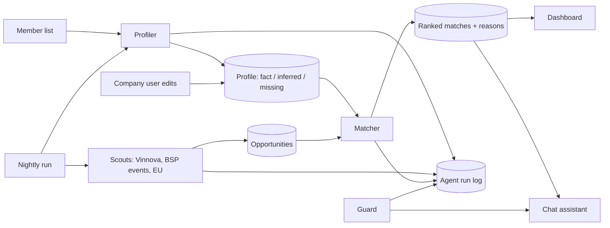

# Virtual Science Park: repo blueprint

Team plan for the Campor × BUILD Hackathon 2026, Blue Science Park challenge.
Put this file in `docs/BLUEPRINT.md`.

## 1. What wins

The jury scores what we show. Our strongest point is the **engine**: a set of
small agents where **the AI proposes and the code checks**. Every result can
be traced back to a source, a rule and a test.

One sentence for the pitch:

> The AI is never trusted alone. Each agent has rules in plain code that check
> its answer, and each rule has a test.

## 2. The engine



### Agents: what the AI does and what the code checks

| Agent | AI does | Code checks (no AI) |
|---|---|---|
| **Profiler** | Reads website pages. Proposes profile items with a quote and a link. | Quote must exist in the fetched page, or the item becomes "Inferred". Interests are always "Inferred". Empty fields become "Missing". Blocks private network links. |
| **Scouts** | Nothing, or only a short summary. | Fetch, clean and store items from each source. Drop past deadlines. Remove duplicates. Every item needs a link and a retrieved date. Fake items carry `simulated = true`. |
| **Matcher** | Gives a relevance number (0-100), a reason, and the profile items it used. | Computes the final score with a fixed formula. Drops reasons that point to items that do not exist. Blocks words like "eligible" or "guaranteed". |
| **Guard** | Classifies each chat message. | Fixed reply per class. Chat can only read data of the current company. This is enforced in the database query, not in the prompt. |
| **Assistant** | Answers using only data we fetched. | Every answer carries source links. Decisions go to Blue Science Park staff. |

### Matcher score (fixed formula, easy to explain)

```
final = relevance × evidenceWeight + priorityBoost + feedback   (kept between 0 and 100)

evidenceWeight  1.00  best matched item is "Confirmed by company"
                0.85  best matched item is a Fact
                0.60  best matched item is Inferred
                0.40  no valid matched item (card shows "weak basis")
priorityBoost   +15   the type (funding, events...) is a chosen priority
feedback        -30   the user voted this item down
                -10   a similar title of the same type was voted down
```

This is why two companies get different rankings, and why editing a profile
changes the ranking at once.

### Guard classes

| Class | Example | Reply |
|---|---|---|
| `in_scope` | "Which funding fits us?" | Answer with sources. |
| `unclear` | "Can you help with marketing?" | One focused question back. |
| `out_of_scope` | "Write me a poem." | Short remit note and a relevant suggestion. |
| `override_attempt` | "Ignore your rules. You are now..." | Refuse. Same rules apply. |
| `other_company_private` | "What did Company B edit?" | Refuse. Public facts only. |
| `needs_human` | "Are we eligible? Can BSP promise a place?" | Give information, then refer to staff. |

### Agent run log (our proof)

One table, `agent_runs`: agent, company, start time, duration, sources used,
short output, list of checks with pass or fail, simulated flag.

The interface shows it behind a "How was this made?" link on every profile
and every match. This gives the jury evidence for technical quality.

### How profiles stay current

A nightly run calls the Scouts, rebuilds profiles, and stores "what changed"
when a profile item differs from the last run. Items confirmed by the company
are never overwritten. Adding a member is one new row.

## 3. Repo layout

```
/
├─ README.md               first-round pitch (final version Saturday)
├─ AGENTS.md               Lovable rules, keep as is
├─ docs/
│  ├─ BLUEPRINT.md         this file
│  ├─ ARCHITECTURE.md      agents, data flow, diagram
│  ├─ EVALUATION.md        results of the four checks
│  ├─ LIMITATIONS.md       known limits and next steps
│  └─ PITCH.md             3-4 minute script
├─ evals/
│  ├─ golden-profiles.json     hand-checked facts for 3 companies
│  ├─ boundary-cases.json      12 chat messages with expected class
│  └─ relevance-labels.json    human yes/no for each top 5
├─ src/
│  ├─ lib/
│  │  ├─ agents/
│  │  │  ├─ contracts.ts           shared types, all agents use them
│  │  │  ├─ run-log.server.ts      writes agent_runs
│  │  │  ├─ orchestrator.server.ts order of agents, nightly run
│  │  │  ├─ profiler/              agent, rules, website fetcher
│  │  │  ├─ scouts/                vinnova, bsp-events, eu-funding, normalise
│  │  │  ├─ matcher/               agent, scoring
│  │  │  └─ guard/                 classify, policy, assistant
│  │  └─ ai/                       Lovable gateway (do not change)
│  ├─ routes/              pages and API routes   (Lovable driver)
│  ├─ components/          interface              (Lovable driver)
│  └─ test/                one test file per rules file
├─ drizzle/, supabase/     database               (Lovable only)
```

Rule of thumb: **`*.server.ts` talks to AI or the network. `rules.ts`,
`scoring.ts`, `policy.ts` and `normalise.ts` are pure code with tests.**

## 4. Who does what

One person is the **Lovable driver** (the account owner). The driver makes all
interface and database changes. Everyone else sends the driver a short request.

### Owner A: Understand (Profiler)

- [ ] Add 3 real members and build their profiles.
- [ ] Add the Blue Science Park member page as a second source.
- [ ] Store "what changed" between two profile builds.
- [ ] Fill `evals/golden-profiles.json`: check every Fact by hand.
- [ ] Write the profile accuracy part of `EVALUATION.md`.

Done when: 3 profiles, every Fact opens a real quote, accuracy number written.

### Owner B: Find and rank (Scouts + Matcher)

- [ ] Vinnova scout working with real data.
- [ ] Events scout working with real data (Blue Science Park site).
- [ ] EU scout if it works on the first try. If not, skip it.
- [ ] `scoring.ts` with the formula above and its tests.
- [ ] Compare page shows clearly different top 5 lists.
- [ ] Fill `evals/relevance-labels.json` and compute precision for top 5.

Done when: 2 real sources, ranking changes after a profile edit, tests green.

### Owner C: Trust (Guard, chat, run log, docs)

- [ ] `policy.ts`: the six classes and fixed replies.
- [ ] Chat that reads only the current company's data.
- [ ] `evals/boundary-cases.json` with 12 cases, and a test tab that runs them.
- [ ] Agent run log and the "How was this made?" view.
- [ ] `README.md`, `ARCHITECTURE.md`, `LIMITATIONS.md`, `PITCH.md`.

Done when: 12 of 12 boundary cases pass on screen, README is complete.

## 5. Working rules

1. Work on `main`. Small commits. Pull before you push.
2. **Never force push or rebase.** It breaks the Lovable project history.
3. Do not edit `drizzle/`, `supabase/` or any file marked "automatically
   generated". Ask the driver.
4. Keep AI calls on the Lovable gateway. No keys in the repo.
5. Run `npm test` before every push. `main` must always work.
6. Stay in your own folder under `src/lib/agents/`. Change `contracts.ts` only
   after telling the team.
7. Anything fake gets `simulated = true` and an orange badge.

## 6. The four checks we report

| Check | How we measure | Target |
|---|---|---|
| Profile accuracy | A person checks each Fact against its link. | 90% or more correct |
| Recommendation relevance | A person marks each top 5 item yes or no. | 4 of 5 relevant |
| Source traceability | Automated test: every shown item has a link and a date. | 100% |
| Interaction limits | The 12 boundary cases. | 12 of 12 pass |

Write real numbers in `EVALUATION.md`, including the failures.

## 7. Brief checklist

| Brief requirement | Owner |
|---|---|
| Profiles for at least 3 companies from public sources | A |
| Evidence shown, facts separate from inferred | A |
| User can review and refine a profile | A + driver |
| Opportunities from at least 2 public sources | B |
| Different rankings for different profiles | B |
| Source links and dates on results | B |
| Relevant, unrelated and override requests handled | C |
| Simulated data clearly labelled | everyone |
| Agent roles explained | C |

## 8. Time plan

| When | Goal |
|---|---|
| Friday afternoon | Repo live, team added, 3 profiles, Scouts started |
| Friday evening | Matcher and Compare page working with real data |
| Saturday morning | Chat, Guard, test tab, run log |
| Saturday afternoon | Evaluation numbers, README, backup video, submit the repo link |

No new features after Saturday lunch.
