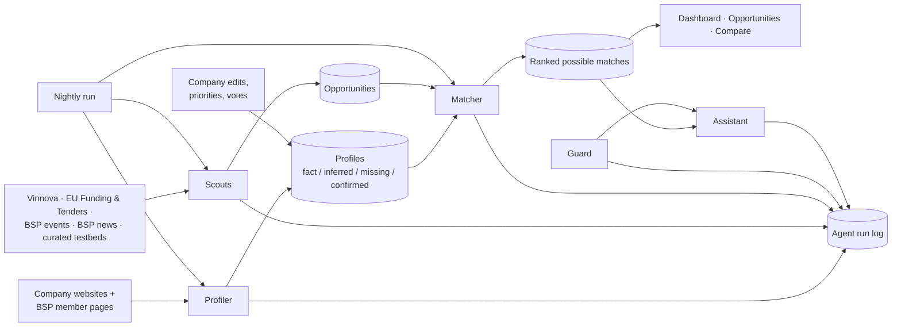

# Virtual Science Park: engineering overview

A short summary of what is built, how it fits together and why, for an
architect or engineer joining the project. Front page and page list:
[../README.md](../README.md). Full detail: [ARCHITECTURE.md](ARCHITECTURE.md).

## 1. What it is

A prototype for the Blue Science Park challenge (BUILD Hackathon, Karlskrona,
13–15 Nov 2026). AI agents build an evidence-backed profile of each member
company from public web pages, collect opportunities from public sources, rank
them per company, and answer questions in a guarded chat.

**Status:** working end to end on a laptop. 112 automated tests pass. Profiles
for 5 member companies were checked by hand.

## 2. The pipeline



Agents never call each other. They share data through database tables, and
fixed code decides the order (nightly run or a button). Every run writes one
row to `agent_runs`, which the "How was this made?" link shows.

| Agent | AI does | Code checks |
|---|---|---|
| Profiler | Fills 8 profile fields from up to 5 pages, each fact with a quote and link | Quote must appear word for word on the page, else **Inferred**; interests always Inferred; empty fields **Missing**; company edits never overwritten |
| Scouts | Nothing | Fetch fixed sources, drop past deadlines and duplicates, label fallback samples **Simulated** |
| Matcher | Relevance 0–100, reason, next step, profile items used | Fixed score formula; drops unknown items; removes "eligible"/"guaranteed" |
| Guard | Labels each chat message (6 classes) | Fixed rule catches override wording first; fixed code picks the reply |
| Assistant | Short answer from this company's data only | Source links, wording filter, staff disclaimer when a human decision is needed |

## 3. Key decisions and why

| Decision | Why |
|---|---|
| **The AI proposes, the code checks.** One structured AI call per agent, no autonomous agent loops. | Predictable and testable; every result traces to a source, a rule and a test. |
| **No model training.** Pretrained models steered by prompts and fixed JSON schemas. | Small data (about 56 members); reliability comes from code checks; quality is measured by people (`evals/`). |
| **Two model options behind one switch** (`src/lib/ai/model.server.ts`): Lovable's AI gateway, or Ollama when `OLLAMA_MODEL` is set. | Work offline without spending Lovable credits; a dispatcher puts chat ahead of background work on the single local model. |
| **Evidence levels:** fact (quote verified) > inferred > missing; company-confirmed on top. Editing an item's text drops its old quote. | The brief requires separating facts from inferred interests; evidence must never claim what a page didn't say. |
| **Deterministic score:** `AI relevance × evidence weight (1.00/0.85/0.60/0.40) + 15 priority − 30 down vote − 10 similar`. Votes and priorities re-rank by code from stored AI scores. | Explainable rankings that differ per profile; feedback acts instantly and exactly, with no AI wait. |
| **Guard: the AI labels, code decides the reply.** A fixed-code pre-check catches override and injection wording (English and Swedish). | No prompt can talk the assistant out of its rules; robust even with a weak local model. |
| **Never claim eligibility.** "Possible match" wording, a wording filter, and a staff contact for decisions. | Required by the brief; the service gives information, not decisions. |
| **Missing data is never silent.** A failing or empty source shows labelled Simulated samples and its status. | The brief requires simulated data to be clearly labelled. |
| **Access rules on the server** (`src/lib/access-rules.ts`) with demo accounts and a signed session cookie. The database still allows anonymous access. | Protects other companies' private data in the app now; database-level rules need a Lovable schema change (next step). |

## 4. Tech stack

TanStack Start (React 19, TypeScript, server functions and streaming HTTP
routes), Tailwind CSS, Supabase (hosted PostgreSQL, reached through its web API
with the publishable key), Vercel AI SDK, Lovable (hosting, AI gateway,
database changes), Ollama (local model, `qwen2.5`), Vitest, Bun.

## 5. Sources (status 13–14 Nov 2026)

| Source | Gives | Status |
|---|---|---|
| Vinnova open data API | Funding: purpose, who can apply, amount, deadline | Live, 15 open calls (6-month look-back) |
| EU Funding & Tenders search API | EU funding calls | Live |
| Blue Science Park news | Regional news and trends | Live |
| Blue Science Park events | Events | API live but no upcoming events, so samples are shown, labelled Simulated |
| Testbeds curated by staff | Testing environments | Samples until staff add the first one |

## 6. Branches and workflow

- `main`: synced with Lovable. Lovable manages the database (`drizzle/`, `supabase/`) and generated files; never edit those by hand.
- `local`: **the demo runs from here**, on a laptop: Ollama, sign-in, own-database setup ([../LOCAL.md](../LOCAL.md)).
- Work on short branches from `local`, open a pull request into `local`, merge it on GitHub. Update a branch with `git merge origin/local`. **Never rebase or force-push** (it breaks Lovable's history).

## 7. Run it

```sh
bun install                      # or npx bun install
cp .env.local.example .env.local # add the team's Supabase URL + publishable key, OLLAMA_MODEL, SESSION_SECRET
ollama pull qwen2.5:7b
npm run dev:local                # http://localhost:8080, demo password bluepark2026
npx bun run test
```

The database is shared: rebuilding a profile locally replaces what everyone
sees, including the hand-checked profiles.

## 8. Known limitations and next steps

- Demo accounts instead of real accounts; database-level access rules not yet in place.
- Events are simulated (no upcoming events in the BSP feed); testbeds need staff input.
- Members are added by hand; BSP's member API lists all 56 and could feed an import.
- The nightly run processes companies in one long request; for all members it should run in batches and skip unchanged websites.
- `EVALUATION.md` still needs the hand-checked numbers.

More: [LIMITATIONS.md](LIMITATIONS.md) · [ARCHITECTURE.md](ARCHITECTURE.md) ·
[PITCH.md](PITCH.md) · [BLUEPRINT.md](BLUEPRINT.md) · [EVALUATION.md](EVALUATION.md)
